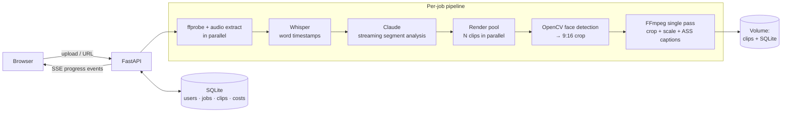

# Cliphook

**Turn a long video into ready-to-post vertical clips, automatically.**

Drop in a podcast, interview or stream (upload or YouTube link). Cliphook transcribes it, asks Claude to find the moments most likely to work as standalone short-form clips, reframes each one to 9:16 around the speaker's face, and burns in animated word-by-word captions.


<!-- TODO: replace with a 10–20s GIF: paste URL → clips appearing one by one -->


> **Live demo:** _TODO: add URL_ · **Built solo, end to end:** pipeline, backend, UI, auth, deployment.

---

## What it does

| Step | What happens |
|------|--------------|
| **1. Ingest** | Upload a video or paste a YouTube URL (via `yt-dlp`). An existing `.srt` transcript can also be used to skip transcription. |
| **2. Transcribe** | Audio is extracted as 16 kHz mono Opus (much smaller than WAV, same Whisper accuracy) and sent to Whisper for **word-level timestamps**. Files above Whisper's 25 MB limit are chunked with overlap and re-stitched. |
| **3. Find the clips** | Claude reads the timestamped transcript and returns segments that stand on their own, with a virality score, title, hook line, topic and hashtags. The user can steer it ("only the parts about pricing"). |
| **4. Reframe** | OpenCV samples frames in each segment, locates the speaker's face and crops a 9:16 window centred on it. Wider crops are used for multi-speaker shots. |
| **5. Caption & render** | Word timings become an `.ass` subtitle file with highlight/animation styles (bold, neon, pop, bounce, glow…). Crop, scale and caption burn-in happen in **one FFmpeg encode pass**. Clips render in parallel. |
| **6. Extras** | Thumbnail candidates with text overlay, re-render a clip in a different caption style, per-job cost tracking. |

<!-- TODO: screenshots -->
| Create | Results |
|--------|---------|
|  |  |

---

## Architecture



**Runtime:** single Docker image (Python 3.11 + FFmpeg with libass) deployed on Railway with a persistent volume for media and the SQLite database.

---

## Key engineering decisions

- **Streaming the LLM response, not waiting for it.** Claude's output is parsed incrementally while it streams, so segments become available as soon as each JSON object is complete. A tolerant parser recovers from code fences and truncated arrays instead of failing the whole job.
- **Server-Sent Events for progress.** Each stage (probe → transcribe → analyze → render) pushes events to the browser, and every finished clip is sent the moment it renders. Long jobs feel responsive without WebSockets or a job queue.
- **The model suggests, code enforces.** Requested clip counts are capped by what the video length can actually hold, and segment durations are clamped after the model responds. Prompt instructions alone aren't trusted for hard constraints.
- **One encode pass per clip.** Crop, scale and subtitle burn-in are a single FFmpeg filter chain, which halves render time and avoids generation loss from re-encoding.
- **Cost visibility built in.** Every job records Whisper minutes, Claude input/output tokens and the total USD cost, so unit economics are known per clip, not guessed.
- **Cheap, predictable infra.** SQLite on a mounted volume and a single container. No queue, no object store, no separate DB service until usage justifies it.

---

## Tech stack

- **Backend:** Python 3.11, FastAPI, Uvicorn, SSE, `ThreadPoolExecutor` for parallel rendering
- **AI:** Anthropic Claude (segment selection), OpenAI Whisper (transcription)
- **Media:** FFmpeg / ffprobe, libass captions, OpenCV (Haar cascade face detection), yt-dlp
- **Auth:** Google OAuth + email/password (bcrypt), signed session cookies, anonymous trial gating
- **Storage:** SQLite
- **Frontend:** vanilla HTML/CSS/JS pages served by FastAPI
- **Deploy:** Docker, Railway (`railway.toml`, health check, restart policy)

---

## Run it locally

**Prerequisites:** Docker, or Python 3.11+ with FFmpeg built with libass (`brew install ffmpeg-full` on macOS).

```bash
# 1. Configure
cp poc/.env.example poc/.env     # then fill in the keys below

# 2a. Docker
docker build -t cliphook .
docker run -p 8080:8080 --env-file poc/.env -v "$PWD/data:/data" cliphook

# 2b. Or plain Python
cd poc
python -m venv .venv && source .venv/bin/activate
pip install -r requirements.txt
uvicorn app:app --reload --port 8080
```

Open <http://localhost:8080>.

| Variable | Required | Purpose |
|----------|----------|---------|
| `ANTHROPIC_API_KEY` | yes | Claude segment analysis |
| `OPENAI_API_KEY` | yes | Whisper transcription |
| `SECRET_KEY` | yes | Signs session cookies |
| `BASE_URL` | for OAuth | Public URL used for the Google OAuth callback |
| `GOOGLE_CLIENT_ID` / `GOOGLE_CLIENT_SECRET` | optional | Google sign-in |
| `CLIPENGINE_AI_MODEL` | optional | Claude model (default `claude-sonnet-4-6`) |
| `CLIPENGINE_AI_MAX_SEGMENTS` | optional | Max clips per video (default 10) |
| `RENDER_WORKERS` | optional | Parallel clip renders |
| `FFMPEG_PRESET` | optional | x264 preset (`ultrafast` in production) |
| `WORK_DIR` / `DB_PATH` | optional | Media and SQLite locations |

---

## Project structure

```
poc/
├── app.py               # FastAPI app, SSE pipeline orchestration, routes
├── analyzer.py          # Claude prompts, streaming + tolerant JSON parsing
├── transcriber.py       # audio extraction, Whisper (with chunking)
├── face_detector.py     # OpenCV face sampling → crop position
├── video_processor.py   # FFmpeg cut / 9:16 reframe / caption burn-in
├── caption_generator.py # word timings → styled, animated .ass subtitles
├── thumbnail.py         # thumbnail candidates + text overlay
├── youtube.py           # URL ingest
├── auth.py              # Google OAuth, email/password, sessions, trials
├── database.py          # SQLite schema + data access
├── costs.py             # per-job Whisper/Claude cost accounting
└── static/              # UI pages
```

---

## Limitations & what I'd do next

- **Face tracking is per-segment, not per-frame.** One crop position per clip works for podcasts but not for speakers who move. Next step: per-shot tracking with smoothing, or a modern detector (MediaPipe/YOLO) instead of Haar cascades.
- **Jobs run inside the request.** Fine at current volume. At scale I'd move rendering to a worker queue so deploys and client disconnects don't interrupt jobs.
- **No automated test suite yet.** The pure functions (JSON recovery, ASS generation, crop maths, cost calculation) would be the first to cover.
- **Virality is judged from text only.** Adding audio energy and visual cues to the prompt would improve selection for non-talking-head content.

---

**Author:** Filip Popov · [LinkedIn](https://linkedin.com/in/filipopov) · filip.popov13@gmail.com
